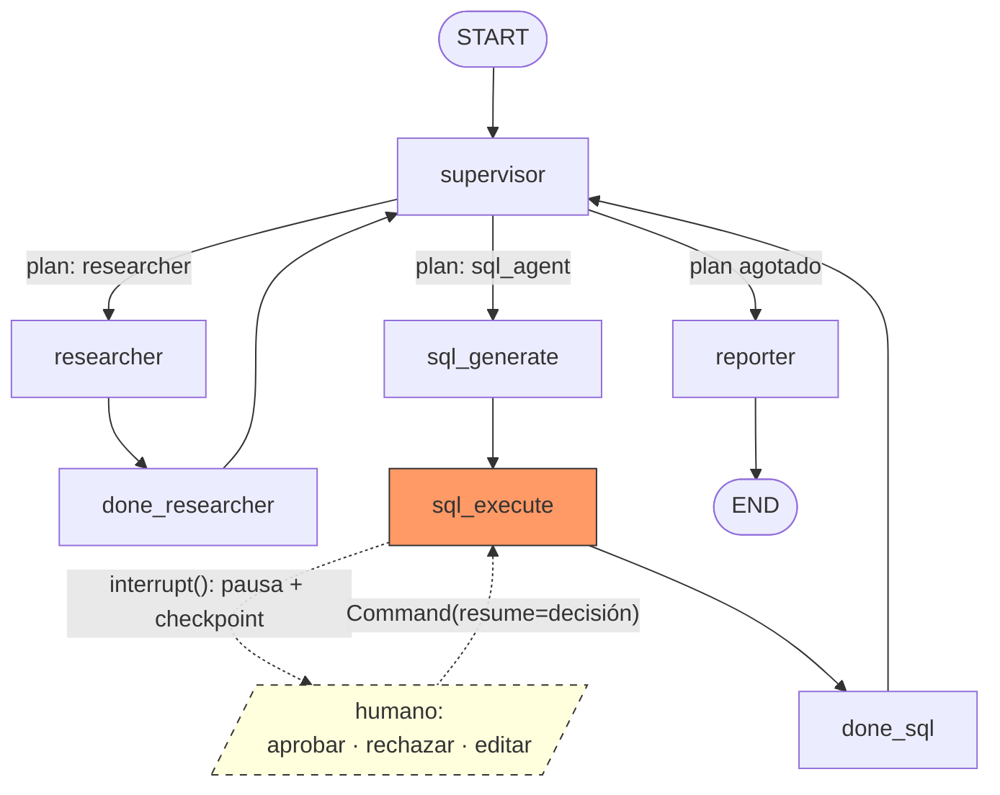

# LangGraph HITL Demo — el checkpoint hace posible la aprobación humana

Demo pequeña y verificable de **human-in-the-loop** sobre un grafo multi-agente de
LangGraph. Idea central: **pausar un grafo para pedir aprobación solo es posible
porque el estado del grafo se persiste en un checkpoint**. Sin checkpointer, la
pausa se emite pero no hay estado que consultar ni punto desde donde reanudar.

Un supervisor reparte el trabajo entre un `researcher` (busca en documentos
locales), un `sql_agent` (propone SQL) y un `reporter`. **El SQL no se ejecuta
hasta que un humano lo aprueba, lo edita o lo rechaza.**

## Corre sin claves de pago

Por defecto la demo usa un **LLM falso y determinista** (`src/llm.py`): responde
con textos fijos según el rol del prompt. Sirve para probar la mecánica del grafo
(routing, `interrupt()`, checkpoint, reanudación), **no la calidad de un modelo**.
El SQL, en cambio, sí se ejecuta de verdad contra SQLite. Si defines
`DEEPSEEK_API_KEY` (y no `FAKE_LLM=1`) se usa DeepSeek vía `langchain-openai`;
esa ruta no está cubierta por la verificación descrita abajo.

## Grafo



## Instalación

Requiere Python 3.11+.

```bash
python -m venv .venv && source .venv/bin/activate
pip install -r requirements.txt
python scripts/seed_db.py        # crea data/sales.db (200 ventas sintéticas, semilla fija)
```

## Cómo correrlo

**1. Demo automática (sin teclado)**, la forma más rápida de ver el patrón:

```bash
python scripts/demo_hitl.py
```

Hace tres cosas: (1) el grafo pausa en `sql_execute` y `executed_sql` sigue en
`None`; (2) un grafo nuevo, con otra conexión SQLite y el mismo `thread_id`,
recupera la pausa del checkpoint y reanuda con `approve`; (3) control: sin
checkpointer, `get_state` falla con `No checkpointer set` y
`Command(resume=...)` con `Cannot use Command(resume=...) without checkpointer`.

**2. CLI interactiva:**

```bash
python -m src.main -q "¿cuáles fueron los 5 productos más vendidos y qué dice la política de descuentos sobre ellos?"
```

Muestra el SQL propuesto y pregunta `[a]probar / [r]echazar / [e]ditar`.

**3. Pausa, "muerte" del proceso y reanudación:**

```bash
python -m src.main -q "top 5 productos" --thread-id sesion-1 --pause-only   # termina en la pausa
python -m src.main -q ignorada --thread-id sesion-1 --decision approve      # proceso nuevo: reanuda
```

El segundo comando detecta el interrupt pendiente en `data/checkpoints.db` y
continúa sin repetir los nodos ya ejecutados.

### Resultado verificado (ejecución real, LLM falso)

Con el SQL aprobado, SQLite devuelve:

| nombre                | categoria   | unidades | ingresos |
|-----------------------|-------------|----------|----------|
| Botella Térmica Polar | Deportes    | 644      | 10937.04 |
| Auriculares BT Nova   | Electrónica | 631      | 26660.27 |
| Mouse Inalámbrico M1  | Electrónica | 508      | 12033.44 |
| Lámpara LED Aura      | Hogar       | 405      | 12323.84 |
| Banda Elástica Pro    | Deportes    | 379      | 4290.35  |

Con `--decision reject` el SQL no se ejecuta (`executed_sql` queda en `None`).

## Por qué el diseño es así

- **Generar el SQL y pedir aprobación viven en nodos distintos.** Al reanudar,
  LangGraph re-ejecuta desde el inicio el nodo interrumpido. Si el LLM estuviera
  en ese mismo nodo, se regeneraría el SQL y podría diferir del que el humano
  vio. Separándolos, `proposed_sql` queda en el checkpoint. Ver `src/agents/sql_agent.py`.
- **`thread_id` identifica la conversación** en el checkpointer (`SqliteSaver`).
  Mismo `thread_id` = misma pausa recuperable.

## Estructura

```
├── requirements.txt
├── data/kb/              # 5 documentos ficticios (políticas, catálogo)
├── scripts/
│   ├── seed_db.py        # crea data/sales.db (3 tablas, datos sintéticos)
│   └── demo_hitl.py      # demo automática: pausa, reanudación, control
└── src/
    ├── graph.py          # estado, nodos, aristas, compilación con checkpointer
    ├── main.py           # CLI: interrupt -> decisión humana -> resume
    ├── llm.py            # LLM falso determinista o DeepSeek
    └── agents/           # researcher, sql_agent (con interrupt), reporter
```

## Límites honestos

- Es una demo didáctica, no un sistema de producción.
- El LLM falso devuelve siempre las mismas respuestas: el reporte final es texto
  fijo y no incorpora la tabla de resultados. Con un LLM real el contenido
  variaría y no se ha verificado aquí.
- Los datos y documentos son sintéticos y ficticios.
- El supervisor siempre planifica `researcher` + `sql_agent` con el LLM falso;
  el routing con un modelo real (JSON del plan) no se probó.
- Guardrails de SQL mínimos: el SQL debe empezar por `SELECT`/`WITH`, se leen
  máximo 50 filas y la base se abre en modo solo lectura (`mode=ro`), de modo
  que una escritura falla aunque pase el chequeo de prefijo. La aprobación humana
  sigue siendo la barrera principal; no se probó contra consultas adversarias.
- La edición de SQL en la CLI es de una sola línea.
- Las versiones de `requirements.txt` son las probadas (Python 3.15, macOS);
  no se probó una matriz de versiones.
- Persistencia con SQLite local: pensada para un solo proceso/usuario.

## Licencia

MIT
